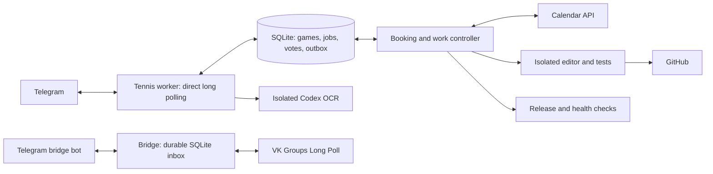

# TT Rating Bot

[English](#english) · [Русский](#russian)

<a id="english"></a>
## English

A Telegram bot for a table tennis group: turn photos of handwritten scores into
confirmed game results, Elo ratings and head-to-head statistics. It also books
the playing room and supports questions and owner-requested code changes through
an AI-assisted `/work` workflow.

Built with Python, SQLite, systemd, Codex OCR and the Telegram and Calendar APIs.
The repository also includes a separately deployed Telegram ↔ VK bridge.
The bot's Telegram interface is in Russian.

### Features

- **Photo recognition.** Read player initials and scores from multiple board
  blocks, match opponents by digit color when a row contains more than two
  players, and exclude subtotals. Process each block from top to bottom, then
  move left to right. Games to 11 and 21 are supported.
- **Two-person confirmation.** Show a text draft with underlined winners and
  rounded Elo changes beside each player. Two distinct group members must
  confirm it before games affect history or ratings. Votes update the original
  message; repeated clicks do not record games again. OCR warnings do not hide
  the confirmation button.
- **Statistics and charts.** Show a 4×4 head-to-head matrix for the latest N games
  (default: 1,000), a custom deuce-based score and all-time Elo. Generate two PNG
  charts: ratings by Moscow calendar date and after each confirmed game.
- **Room booking.** Schedule bookings, invite participants, support manual
  creation and cancellation, and return a calendar link. Send one initial
  message and edit it for meaningful status changes.
- **AI-assisted maintenance.** Answer questions about the group's games and
  ratings, or implement an owner's change request, test it, push it to GitHub
  and deploy it. Only the final result is sent to the chat.

### Architecture

Since **10 October 2026**, both bots run on `ilya-grid-vm` without Yandex Cloud
runtime services. Telegram uses direct long polling over DNS/IPv6; the bridge
receives VK events through Groups Long Poll. A local Mac or open SSH session is
not required to keep the services running.



The paid cloud resources used by the previous deployment were retired. The
current setup still relies on the existing host and ChatGPT access; these are
separate from Yandex Cloud resource costs.

### Usage

Send a photo, review the recognized games and press **«Подтвердить»**. Two
participants must vote. Until the second vote, Elo changes are provisional.
The roster is М — Максим (Maxim), И — Илья (Ilya), Р — Рома (Roma),
В — Валя (Valya).

| Command | Behavior |
| --- | --- |
| `/confirm` | Vote for the group's latest draft; the inline button is the usual option. |
| `/stat N` | Statistics for the latest N confirmed active games; N defaults to 1,000. |
| `/elo_graph` or `/graph` | One album with Elo charts by day, all games, and today/latest photo. |
| `/elo_chase` | Consecutive wins Ilya needs against Maxim to strictly overtake him in Elo, assuming no other games. Does not change ratings. |
| `/work question or task` | Questions for all group members; code, configuration and permission changes for the authenticated owner only. |
| `/create_booking YYYY-MM-DD HH:MM MINUTES` | Owner-only booking attempt; manual duration defaults to 60 minutes, maximum 90. With no arguments, use the next Monday or Thursday at 19:00. |
| `/cancel_booking YYYY-MM-DD HH:MM` | Owner-only cancellation of a meeting managed by this bot. Omit the time if the date has one booking, or omit all arguments for the next future booking. |

The statistics matrix uses **winners as rows and losers as columns**. Off-diagonal
cells count wins within the selected window. Diagonal cells contain each player's
custom score: a win gives +1; a loss gives −1 before deuce or 0 after deuce.
Deuce is 10:10 for games to 11 and 20:20 for games to 21. An unlabeled 21:19
result is treated as a game to 21 for this metric.

Elo is shown separately and uses the entire confirmed history, regardless of N.
Initial rating: **1,000**, default **K = 32**, updated after every game:

```text
E_A = 1 / (1 + 10^((R_B - R_A) / 400))
R_A_new = R_A + K × (S_A - E_A)
S_A = 1 for a win, 0 for a loss
```

Player B is updated symmetrically. Displayed changes are rounded to integers;
calculations retain full precision.

### Booking policy

The scheduler runs on **Mondays and Fridays at 19:01 Europe/Moscow**, requesting
one slot three days ahead, **19:00–21:30** on Thursday or Monday respectively.
The regular duration is configured as `regular_minutes` in `booking-policy.json`.
The room's published self-service limit is 90 minutes; the owner explicitly
requested a single 150-minute attempt. A refusal is reported without silently
shortening or splitting the slot.

The configured room is `conf_mm_5_15@yandex-team.ru`. New meetings invite
`klim-roma@yandex-team.ru` and `polyanskiy-mn@yandex-team.ru`. The meeting title
is «Настольный теннис» and its description is empty. The integration uses the
public Calendar API at `https://cloud-api.yandex.net/v1/calendar`.

A created event is distinguished internally from a resource-confirmed booking:
HTTP 201 or a room name alone does not prove acceptance. Missing resource
metadata does not produce repeated chat warnings. Explicit refusals and
cancellations update the original message. A lost creation response does not
trigger a blind second POST, and conflicts never move the slot or alter someone
else's booking.

### How `/work` operates

1. Classify and answer the request in a read-only stage using a snapshot of
   tennis data. Questions do not create commits or deploy code.
2. For changes, verify the sender's actual Telegram ID before starting an
   isolated editor. The owner can modify all project code, including permissions,
   the controller and deployment logic.
3. Test a separate candidate under a dedicated Unix user without network,
   production data or credentials. Failed tests return bounded, redacted
   diagnostics for up to two repair attempts.
4. Publish and deploy only a passing candidate. Check service startup and use a
   guard to restore the previous code if controller startup fails, preserving
   the game database. Report one final outcome.

Infrastructure failures, timeouts, pushes and deployments are not blindly
retried by the test-repair loop. See [work runner details](docs/work-runner.md).

### Reliability and operations

Incoming Telegram batches commit to SQLite before the polling offset advances.
Jobs, votes, confirmed games, Elo updates and outgoing messages are persisted;
replayed updates and recognized duplicate photos do not count games twice.
SQLite uses FULL/WAL, services restart under systemd, and daily database backups
retain 30 copies. The bridge has its own database, service and backup timer.

An optional [Google Sheets history backup](docs/google-backup.md) copies confirmed
games, scores and Elo changes off the host. It updates after the second vote,
retries failed writes and retains cancelled games with a status marker.

OCR runs as a separate user through a Unix socket without access to the database
or service credentials. Photo content is treated as data, not instructions.
Secrets stay outside Git; the tennis service uses encrypted systemd credentials.

Telegram has no `sendMessage` idempotency key: a crash after delivery but before
recording success may duplicate a reply, although it does not duplicate games
or Elo. Cropped or substantially re-encoded photos may evade fingerprint
matching. Backups on the same disk do not protect against loss of the host.

| Component | Location |
| --- | --- |
| Tennis runtime | `/opt/ttar` |
| Tennis database / configuration | `/var/lib/ttar/history.sqlite3` / `/etc/ttar/config.json` |
| Tennis services | `ttar-worker`, `ttar-ocr`, `ttar-maintenance` |
| Tennis backups | `/var/backups/ttar` via `ttar-backup.timer` |
| Bridge runtime / database | `/opt/tg-vk-bridge` / `/var/lib/tg-vk-bridge/history.sqlite3` |
| Bridge service / backup timer | `tg-vk-bridge` / `tg-vk-bridge-backup.timer` |

For direct transport configuration and deployment, see
[direct-host deployment](docs/direct-host.md). Controller installation uses
`scripts/install_maintenance.py --direct`; ordinary releases do not provision
cloud resources. The bridge is deployed separately from tennis `/work` releases.

### Development

Use Python 3.12, as in the deployed runtime. From the repository root:

```bash
python3 -m venv .venv
.venv/bin/python -m pip install -r requirements-dev.txt
.venv/bin/python -m pytest -q
```

Production also requires Linux/systemd, authenticated Codex OCR, Telegram and
Calendar credentials, a repository-scoped GitHub deploy key, and bubblewrap with
working user namespaces for `/work`. The test commands above do not set up a
production bot. Bridge dependencies are in `bridge/requirements.txt`.

Tests cover game rules, Elo, recognition handling, confirmation votes,
deduplication, statistics and graphs, booking policies, the work/release
pipeline and direct transport. The migration was additionally checked with real
message delivery in both directions, photo recognition, service restarts and
preservation of game history.

Operational background, older recovery procedures and the retired cloud design
are preserved in the [archived Russian README](docs/legacy-readme.md). Its cloud
commands, resource IDs, prices and acceptance checklist are historical.

---

<a id="russian"></a>
## Русский

Telegram-бот для компании, которая играет в настольный теннис: превращает фото
рукописного счёта в подтверждённые результаты, рейтинг Elo и статистику личных
встреч. Также бронирует зал и поддерживает вопросы и изменения кода через
AI-процесс `/work`.

Стек: Python, SQLite, systemd, Codex OCR, Telegram API и Calendar API.
В репозитории также находится отдельно развёрнутый мост Telegram ↔ VK.
Интерфейс бота в Telegram — на русском.

### Возможности

- **Распознавание фотографий.** Несколько блоков с инициалами и счётом,
  определение пар по цвету цифр, если в строке больше двух игроков, исключение
  итогов. Порядок — сверху вниз внутри блока, затем слева направо между блоками.
  Поддерживаются партии до 11 и до 21.
- **Подтверждение двумя участниками.** Текстовый список с подчёркнутыми
  победителями и округлёнными изменениями Elo рядом с именами. Результаты
  попадают в историю после двух разных голосов. Счётчик обновляется в исходном
  сообщении, повторные нажатия не добавляют игры заново. Замечания OCR не
  скрывают кнопку подтверждения.
- **Статистика и графики.** Матрица личных встреч 4×4 за последние N игр
  (по умолчанию 1000), отдельные баллы с учётом баланса и Elo за всю историю.
  Один альбом из трёх PNG-графиков: рейтинг по дням, по всем подтверждённым партиям
  и за сегодня (если сегодня партий нет — по последнему подтверждённому фото).
  Короткие заголовки размещены на самих графиках; длинных подписей нет.
- **Бронирование зала.** Расписание, приглашение участников, ручное создание
  и отмена, ссылка на встречу. Одно исходное сообщение, которое обновляется
  при существенном изменении статуса.
- **Доработки через AI.** Ответы на вопросы об играх и рейтингах либо изменение
  бота по просьбе владельца: тесты, публикация в GitHub и развёртывание.
  В чат приходит только финальный результат.

### Архитектура

С **10 октября 2026 года** оба бота работают на `ilya-grid-vm` без сервисов
Yandex Cloud. Telegram подключён напрямую через long polling и DNS/IPv6;
мост получает события VK через Groups Long Poll. Mac и открытая SSH-сессия
для работы не нужны. Общая схема приведена в английской части выше.

Платные ресурсы прежней облачной схемы удалены. Текущая установка использует
существующую рабочую VM и доступ к ChatGPT — это отдельные зависимости,
не расходы на ресурсы Yandex Cloud.

### Как пользоваться

Пришли фото, проверь список и нажми **«Подтвердить»**. Нужны два разных участника.
До второго голоса изменения Elo предварительные. Игроки: М — Максим,
И — Илья, Р — Рома, В — Валя.

| Команда | Действие |
| --- | --- |
| `/confirm` | Голос за последний черновик группы; обычно используется кнопка под списком. |
| `/stat N` | Статистика последних N подтверждённых активных партий; по умолчанию 1000. |
| `/elo_graph` или `/graph` | Альбом Elo: по дням, всем партиям и за сегодня/последнее фото. |
| `/elo_chase` | Сколько побед подряд Илье нужно над Максимом для строгого обгона в Elo, если других игр нет. Рейтинг не меняется. |
| `/work вопрос или задача` | Вопросы доступны всем участникам; изменения кода, настроек и прав — только владельцу с проверенным Telegram ID. |
| `/create_booking YYYY-MM-DD HH:MM MINUTES` | Попытка брони, только для владельца. Ручная длительность — 60 минут по умолчанию, максимум 90. Без аргументов — ближайший понедельник или четверг в 19:00. |
| `/cancel_booking YYYY-MM-DD HH:MM` | Отмена нашей встречи, только для владельца. Время можно опустить, если бронь в этот день одна; без аргументов выбирается ближайшая будущая бронь. |

В матрице **строка — победитель, столбец — проигравший**. Вне диагонали —
количество побед в выбранном окне. На диагонали — сумма баллов игрока:
за победу +1, за поражение до баланса −1, после баланса 0.
Баланс — 10:10 для партий до 11 и 20:20 для партий до 21.
Счёт 21:19 без подписи формата для этой метрики считается партией до 21.

Elo выводится отдельно и считается по всей подтверждённой истории независимо
от N. Начальный рейтинг — **1000**, по умолчанию **K = 32**. После каждой партии:

```text
E_A = 1 / (1 + 10^((R_B - R_A) / 400))
R_A_new = R_A + K × (S_A - E_A)
S_A = 1 при победе, 0 при поражении
```

Рейтинг второго игрока меняется симметрично. В сообщениях изменения округляются
до целых, расчёты сохраняют полную точность.

### Правила бронирования

Автоматическая попытка — **в понедельник и пятницу в 19:01 Europe/Moscow**,
на три дня вперёд: соответственно четверг и понедельник, **19:00–21:30**,
одной заявкой. Длительность задаётся полем `regular_minutes` в
`booking-policy.json`. По паспорту самостоятельная бронь ограничена 90 минутами;
владелец явно запросил попытку на 150 минут. При отказе слот не сокращается
и не делится автоматически.

Зал: `conf_mm_5_15@yandex-team.ru`. Приглашённые:
`klim-roma@yandex-team.ru` и `polyanskiy-mn@yandex-team.ru`.
Название встречи — «Настольный теннис», описание пустое.
Используется публичный Calendar API: `https://cloud-api.yandex.net/v1/calendar`.

Внутри системы создание встречи отличается от подтверждения ресурсом:
HTTP 201 или название зала сами по себе не доказывают принятие брони.
Отсутствие метаданных ресурса не порождает повторных предупреждений в чате.
Явный отказ и отмена обновляют исходное сообщение. Потеря ответа создания
не запускает второй POST вслепую; конфликт не меняет время и чужие брони.

### Как работает `/work`

1. Разбор запроса и ответ в режиме чтения по снимку теннисных данных.
   Вопросы не создают коммиты и не запускают развёртывание.
2. Перед изменениями проверяется реальный Telegram ID отправителя.
   Владелец может менять весь код, включая права, контроллер и выпуск версий.
3. Отдельная копия проверяется под выделенным Unix-пользователем без сети,
   рабочей БД и секретов. При падении тестов исполнитель получает ограниченную
   диагностику с маскированием секретов и до двух попыток исправления.
4. Только прошедшая проверки версия публикуется и развёртывается.
   Проверяется запуск сервисов; при сбое старта контроллера отдельный guard
   восстанавливает предыдущий код, сохраняя БД игр. В чат приходит один итог.

Сбои инфраструктуры, таймауты, публикация и развёртывание не повторяются вслепую
в цикле исправления тестов. Подробности: [work runner](docs/work-runner.md).

### Надёжность и эксплуатация

Пакет Telegram updates сохраняется в SQLite до продвижения offset.
Задания, голоса, игры, изменения Elo и исходящие сообщения сохраняются;
повторные updates и распознанные дубли фотографий не добавляют игры заново.
SQLite работает в FULL/WAL, сервисы перезапускает systemd, ежедневные резервные
копии БД хранятся в количестве 30 штук. У моста отдельные БД, сервис и таймер копий.

[Копия истории в Google Sheets](docs/google-backup.md) сохраняет подтверждённые
игры, счёт и изменения Elo вне VM. Обновляется после второго голоса, повторяет
неудачные записи и сохраняет отменённые партии с соответствующей отметкой.

OCR работает от отдельного пользователя через Unix socket, без доступа к БД
и сервисным ключам. Текст фото рассматривается как данные, а не инструкции.
Секреты находятся вне Git; теннисный сервис использует зашифрованные systemd
credentials.

У Telegram `sendMessage` нет ключа идемпотентности: авария после доставки,
но до записи успеха может дать повтор ответа, однако не игры или Elo.
Обрезанное или существенно перекодированное фото может обойти проверку
дубликатов. Копии на том же диске не защищают от потери всей VM.

| Компонент | Расположение |
| --- | --- |
| Код теннисного бота | `/opt/ttar` |
| БД / конфигурация | `/var/lib/ttar/history.sqlite3` / `/etc/ttar/config.json` |
| Сервисы теннисного бота | `ttar-worker`, `ttar-ocr`, `ttar-maintenance` |
| Резервные копии | `/var/backups/ttar`, таймер `ttar-backup.timer` |
| Код / БД моста | `/opt/tg-vk-bridge` / `/var/lib/tg-vk-bridge/history.sqlite3` |
| Сервис / таймер копий моста | `tg-vk-bridge` / `tg-vk-bridge-backup.timer` |

Настройка прямого транспорта: [direct-host deployment](docs/direct-host.md).
Контроллер устанавливается через `scripts/install_maintenance.py --direct`;
обычные обновления не создают облачные ресурсы. Мост развёртывается отдельно
от обновлений теннисного бота через `/work`.

### Разработка

Используется Python 3.12, как на рабочем сервере. Из корня репозитория:

```bash
python3 -m venv .venv
.venv/bin/python -m pip install -r requirements-dev.txt
.venv/bin/python -m pytest -q
```

Для рабочего бота дополнительно нужны Linux/systemd, авторизация Codex OCR,
ключи Telegram и Calendar, GitHub deploy key для этого репозитория,
а для `/work` — bubblewrap с работающими user namespaces.
Команды выше устанавливают окружение тестов, а не рабочий бот.
Зависимости моста находятся в `bridge/requirements.txt`.

Тесты покрывают правила игр, Elo, обработку распознавания, голоса,
дедупликацию, статистику и графики, правила бронирования, процесс `/work`
и выпуска версий, прямой транспорт. При переносе дополнительно проверены
реальная доставка сообщений в обе стороны, OCR, перезапуск сервисов
и сохранность истории игр.

Предыдущие эксплуатационные заметки, процедуры восстановления и облачная схема
сохранены в [архиве README](docs/legacy-readme.md). Облачные команды, ID ресурсов,
цены и приёмочный чеклист в архиве относятся к прежней установке.
